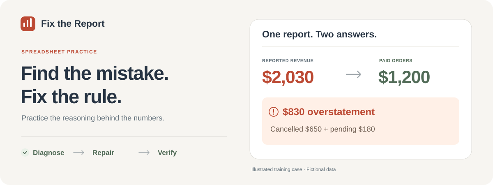
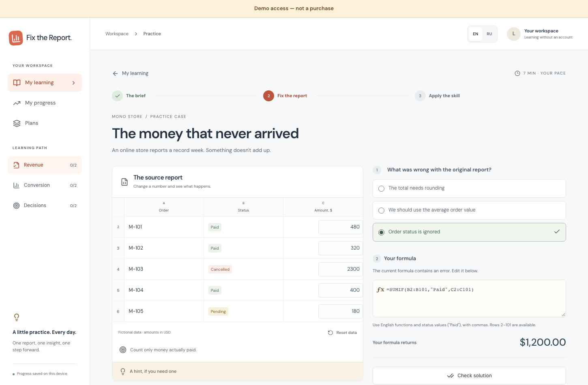

<div align="center">



**English** · [Русский](README.ru.md)

**Practice the judgment behind a spreadsheet.**

[Try the live demo](https://fix-the-report-zimran-n362.decent-chair-7924.chatgpt.site) · [Read the pitch](docs/submission/Fix-the-Report-Pitch-v2.pdf) · [Run locally](#run-locally)

React 19 · TypeScript · Vite · Web Workers · EN / RU

</div>

A store reports **$2,030 in revenue**. Only **$1,200 was paid**. Your job: find the faulty assumption, repair the formula, and prove the fix works when the data changes.

**Fix the Report** is a browser learning app with six business-report lessons and a connected Work Trial. You work with editable reports, executable formulas and explained feedback. Built for the **Zimran × AIESEC hackathon**, in the Skills track.

> **The public demo opens all content.** It displays “Demo access — not a purchase.” No account or payment is needed. English opens by default; the EN/RU switch remembers your choice.

[The learning loop](#the-learning-loop) · [Two-minute demo](#two-minute-demo) · [Lessons](#lessons) · [Build and verify](#build-and-verify) · [Project status](#project-status) · [Materials](#materials)

## The learning loop

| Step | What you do | What the app checks |
| --- | --- | --- |
| **01 · Investigate** | Change figures and inspect the report. | Show how the reported result responds. |
| **02 · Diagnose** | Choose the assumption that caused the error. | Compare your diagnosis with the case rule. |
| **03 · Repair** | Write a formula or choose a business decision. | Test formulas on varied data; check decisions against the report. |
| **04 · Transfer** | Answer a question in a new situation. | Check whether you can apply the rule again. |
| **05 · Review** | Read the breakdown and choose your next step. | Save the attempt, hints and result on this device. |



*Prepared demo run using fictional exercise data. This is the working interface, not a customer result.*

## Two-minute demo

1. Open [**The money that never arrived**](https://fix-the-report-zimran-n362.decent-chair-7924.chatgpt.site/#lesson/revenue-cancelled), then **Open the report**.
2. Change the cancelled order from **650** to **2300**. Enter `2300` without a currency symbol or thousands separator. The original `SUM` total rises to **$3,680**, although paid revenue stays **$1,200**.
3. Select **Order status is ignored** and enter:

   ```excel
   =SUMIF(B2:B101,"Paid",C2:C101)
   ```

4. Select **Check solution**. The formula is checked against **7 datasets**, including new rows, changed statuses and an empty report.
5. Answer the transfer question with **$900 in paid revenue**. Choose by meaning: answer order can change. Open the review.

| Prepared attempt | Repair checks | Final score | Outcome |
| --- | ---: | ---: | --- |
| Working formula; correct diagnosis and transfer | 7 / 7 | **100 / 100** | Lesson completed |
| Constant `=1200`; correct diagnosis and transfer | 1 / 7 | **57 / 100** | Practice only |
| Revealed solution; otherwise correct answers | 7 / 7 | **75 / 100 maximum** | Practice only |

Change the cancelled amount again: the repaired paid total stays the same. `=SUMIFS(C2:C101,B2:B101,"Paid")` is also supported.

**How scoring works:** 20 points for diagnosis + up to 50 for repair + 30 for transfer. Completion requires every repair check, a correct transfer answer, at least 80 points and no revealed solution. Revealing a solution caps repair credit at 25. These scores describe the exercise, not hiring readiness or a qualification.

## Lessons

Three skills, each with a foundation lesson and a practice lesson:

| Skill | Foundation · Free | Practice · Pro proposal |
| --- | --- | --- |
| **Revenue** | Cancelled orders inflate revenue. | Paid orders can still be refunded. |
| **Conversion** | Averaging percentages hides different volumes. | A missing channel changes the overall result. |
| **Decisions** | More sales can produce less value per advertising dollar. | The better decision can be to hold the budget. |

**Work Trial** combines revenue, conversion and a channel decision in one assignment, with **30 checks** and new assignment variants. It has its own scoring, separate from lesson scores.

**Free:** three foundation lessons and repeat practice. **Pro hypothesis: $19/month** for three practice lessons and Work Trial. The pricing screen is implemented; checkout and subscription billing are not connected. The demo lets reviewers explore both tiers.

The initial audience hypothesis is people preparing for analyst or sales-operations spreadsheet assessments, within the event’s **US, ages 25–45** audience. Demand, willingness to pay and learning outcomes still need user research.

## Run locally

Use **Node.js 26.x**; the recorded release was tested with **26.13.0**. The current toolchain also supports Node **22.12+ within 22.x**, **24.x**, and **26+**. No API keys or application backend are required.

```sh
git clone https://github.com/Nurdaulet362/Kiker_BC2_Z_A.git
cd Kiker_BC2_Z_A
npm ci
VITE_DEMO_ACCESS=true npm run dev -- --port 5173 --strictPort
```

Open **[http://127.0.0.1:5173/](http://127.0.0.1:5173/)**. Keep the terminal running. This starts the all-content demo; opening `index.html` directly from disk will not start the app.

<details>
<summary>Windows PowerShell: set the demo flag before starting</summary>

After cloning and running `npm ci`:

```powershell
$env:VITE_DEMO_ACCESS="true"
npm run dev -- --port 5173 --strictPort
```

For normal mode, set the value to `"false"`. Other environment-variable examples below use macOS/Linux shell syntax.

</details>

## Build and verify

| Mode | Access | Output |
| --- | --- | --- |
| **Normal** | Foundation lessons and repeats; practice lessons and Work Trial lead to pricing. | `dist/` |
| **Demo** | All lessons and Work Trial, with the persistent demo banner. | `dist-demo/` |

Build and preview the demo:

```sh
VITE_DEMO_ACCESS=true npm run build -- --outDir dist-demo
npm run preview -- --outDir dist-demo --port 4174 --strictPort
```

Open [http://127.0.0.1:4174/](http://127.0.0.1:4174/). For normal mode, use `VITE_DEMO_ACCESS=false npm run build` and `npm run preview -- --port 4173 --strictPort`.

Only the exact string `true` enables demo access, **at build time**. Changing the flag when starting preview does not change an existing build. Both outputs can be served by a static host. For a subdirectory deployment, configure Vite’s `base` so assets resolve correctly; hash routing alone does not fix asset paths. See [build modes](docs/BUILD_MODES.md).

**Recorded release check · 15 November 2026 · [`ace8eb9`](https://github.com/Nurdaulet362/Kiker_BC2_Z_A/commit/ace8eb9aa224b239e18d772dd4010dff11ff595d)**

| Check | Demo release result |
| --- | --- |
| Clean public clone, `npm ci`, TypeScript, production build | Passed |
| Unit tests | **310 / 310** |
| Chromium e2e against local production preview | **91 / 91** |
| Chromium e2e against the published demo | **91 / 91** |
| Published assets compared with the clean build | **24 / 24 SHA-256 matches** |

These are recorded release results, not a live CI badge or a new test run for this README. [Release details and limits](docs/submission/DEMO_RELEASE_V2.md). Normal mode was verified in the [earlier audit](docs/AUDIT_FIXES_REPORT.md); it was not rerun for this demo deployment.

<details>
<summary>Reproduce checks in both build modes</summary>

After `npm ci`, install Chromium once:

```sh
npx playwright install chromium
npx tsc -b
```

**Normal mode — first terminal:**

```sh
VITE_DEMO_ACCESS=false npm test
VITE_DEMO_ACCESS=false npm run build
npm run preview -- --port 4173 --strictPort
```

**Normal mode — second terminal:**

```sh
VITE_DEMO_ACCESS=false PLAYWRIGHT_BASE_URL=http://127.0.0.1:4173 npm run test:e2e
```

**Demo mode — first terminal:**

```sh
VITE_DEMO_ACCESS=true npm test
VITE_DEMO_ACCESS=true npm run build -- --outDir dist-demo
npm run preview -- --outDir dist-demo --port 4174 --strictPort
```

**Demo mode — second terminal:**

```sh
VITE_DEMO_ACCESS=true PLAYWRIGHT_BASE_URL=http://127.0.0.1:4174 npm run test:e2e
```

Keep each preview running while its browser suite runs. The test flag must match the served build. Run browser suites sequentially, since they share output directories. `PW_CHANNEL=chrome` selects installed Chrome; `PW_ALL_BROWSERS=1` also enables Firefox and WebKit after those browsers are installed. The reported results above cover Chromium only.

</details>

## Under the hood

```text
React interface → worker queue → formula / decision checks → scored review
        ↕
Local progress, drafts and saved attempts in this browser
```

- **React 19 + TypeScript + Vite** for the interface and static build.
- **Web Workers** for calculations, with request cancellation, timeouts and recovery.
- **fast-formula-parser 1.0.19** with an explicit function allowlist. Custom functions use the library’s extension mechanism; arbitrary JavaScript evaluation is not used.
- **Local storage** for drafts, language and results, with validation, cross-tab merge handling and an in-page fallback warning when storage fails.
- **Vitest + Playwright** for calculations, persistence, worker recovery and complete user flows.

<details>
<summary>Formula support and code map</summary>

Supported functions: `SUM`, `SUMIF`, `SUMIFS`, `SUMPRODUCT`, `IF`, `IFERROR`, `COUNT`, `COUNTA`, `COUNTIF`, `COUNTIFS`, `AVERAGE`, `MIN`, `MAX`, `ABS`, `ROUND`, `AND`, `OR`, `NOT`, `N`.

Function names and status criteria remain English in both interfaces. Use `"Paid"` exactly: matching is case-sensitive, so `"paid"` gives a different result. This is a restricted formula environment, not full Excel compatibility. See the [technical handoff](docs/PROJECT_HANDOFF.md) for range, argument and empty-cell behavior.

| Path | Responsibility |
| --- | --- |
| [`src/learning/`](src/learning/) | Lesson content, workspace, scoring and saved reviews |
| [`src/simulation/`](src/simulation/) | Work Trial and its assessment |
| [`src/formula.ts`](src/formula.ts) | Formula validation and execution |
| [`src/worker-pool.ts`](src/worker-pool.ts) | Worker queue, cancellation and recovery |
| [`src/session-storage.ts`](src/session-storage.ts) | Deferred storage writes and change notifications |
| [`src/access.ts`](src/access.ts) | Normal/demo access and optional interest-link configuration |
| [`tests/`](tests/) | Unit tests and browser scenarios |

Useful routes: `/#lesson/revenue-cancelled`, `/#progress`, `/#pricing`, `/#trial`. The old `/#practice` link redirects to the first lesson. Saved review URLs refer to results in the same browser.

</details>

## Project status

| Working today | Planned or not yet validated |
| --- | --- |
| Six authored lessons, hints and explained reviews | Fresh generated variants across the six lessons |
| Saved progress, retries and next-step recommendations | Weekly practice goals and measured return behavior |
| Work Trial with changing figures | More report types for use after hiring |
| Free/Pro pricing screen and explicit demo access | Payments, accounts and server-validated subscriptions |
| English/Russian interface with saved choice | User-study results, price validation and learning impact |

There are **no user-study or interest-form results yet**. `PRO_INTEREST_URL` is empty, so the interest button is hidden. There is no live AI service, email collection or notification service. Client-side access controls are not a secure payment system.

Progress belongs to this browser: clearing its data removes it, and local storage is not account sync. If storage fails, the in-page fallback can be lost when the page closes. Firefox, WebKit and physical phones were not verified in the recorded demo release.

The project explores consumer skills learning in the event’s context. It does not claim a partnership with or endorsement by Zimran.

## Materials

| Material | Link |
| --- | --- |
| **Pitch · 10 slides** | [English PDF](docs/submission/Fix-the-Report-Pitch-v2.pdf) · [Русский PDF](docs/submission/Презентация_BC2_Z_A.pdf) |
| **Speaker notes** | [English](docs/submission/PITCH_SLIDES_V2.md) · [Русский](docs/submission/PITCH_SLIDES_V2_RU.md) |
| **Two-minute demo** | [Video](docs/submission/Fix-the-Report-Demo.webm) · [Script](docs/submission/DEMO_SCRIPT.md) |
| **Business assumptions and sources** | [Evidence ledger](docs/submission/PITCH_V2_EVIDENCE.md) |
| **Next user-research step** | [Pilot protocol](docs/submission/PILOT_PROTOCOL.md) · [Empty results template](docs/submission/PILOT_RESULTS_TEMPLATE.csv) |
| **Questions for the team** | [Jury Q&A](docs/submission/JURY_QA_V2.md) |
| **Developer context** | [Technical handoff](docs/PROJECT_HANDOFF.md) · [First case](docs/CASE_CONTEXT.md) · [Build modes](docs/BUILD_MODES.md) |

Older reports describe their own release snapshots. The current demo’s recorded verification is in [Demo release v2](docs/submission/DEMO_RELEASE_V2.md).

---

**Try changing one number. Then make the rule hold.** [Open Fix the Report →](https://fix-the-report-zimran-n362.decent-chair-7924.chatgpt.site)
