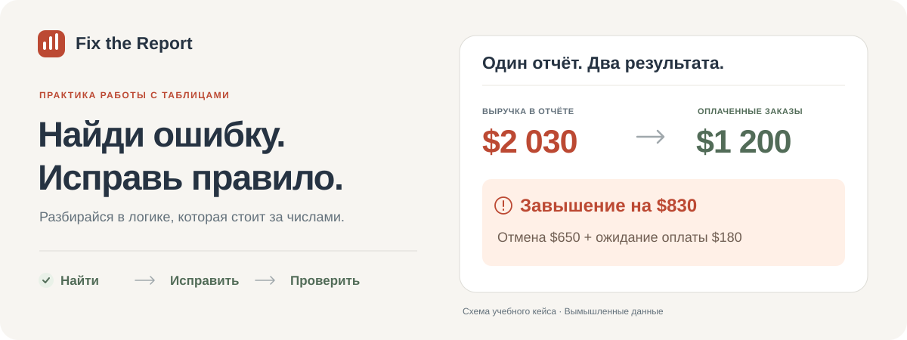
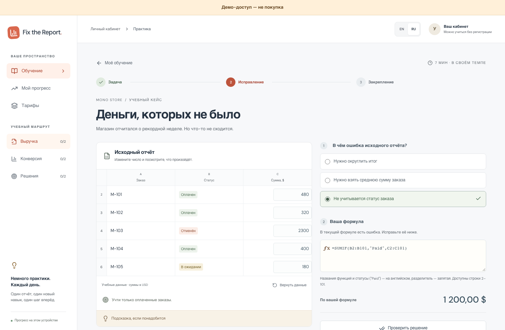

<div align="center">



[English](README.md) · **Русский**

**Учись понимать решения, которые стоят за формулой.**

[Открыть демо](https://fix-the-report-zimran-n362.decent-chair-7924.chatgpt.site) · [Посмотреть презентацию](docs/submission/Презентация_BC2_Z_A.pdf) · [Запустить локально](#локальный-запуск)

React 19 · TypeScript · Vite · Web Workers · EN / RU

</div>

Магазин показывает **$2 030 выручки**. Оплачено только **$1 200**. Твоя задача — найти неверное допущение, исправить формулу и доказать, что решение выдерживает изменение данных.

**Fix the Report** — браузерный тренажёр с шестью уроками на бизнес-отчётах и связанным рабочим заданием Work Trial. Здесь можно менять данные, исполнять формулы и получать разбор решения. Проект создан для **хакатона Zimran × AIESEC**, направление Skills.

> **В публичном демо открыты все задания.** На экране есть плашка «Демо-доступ — не покупка». Аккаунт и оплата не нужны. По умолчанию интерфейс английский; переключатель EN/RU сохраняет выбор языка.

[Как устроено обучение](#как-устроено-обучение) · [Демо за две минуты](#демо-за-две-минуты) · [Уроки](#уроки) · [Сборка и проверки](#сборка-и-проверки) · [Состояние проекта](#состояние-проекта) · [Материалы](#материалы)

## Как устроено обучение

| Шаг | Что делаешь ты | Что проверяет приложение |
| --- | --- | --- |
| **01 · Исследование** | Меняешь числа и изучаешь отчёт. | Показывает, как меняется итог. |
| **02 · Диагностика** | Выбираешь причину ошибки. | Сопоставляет ответ с правилом кейса. |
| **03 · Исправление** | Пишешь формулу или выбираешь бизнес-решение. | Проверяет формулы на разных данных, решения — по текущему отчёту. |
| **04 · Перенос** | Применяешь то же правило в новой ситуации. | Проверяет ответ в новой ситуации. |
| **05 · Разбор** | Изучаешь оценку и выбираешь следующий шаг. | Сохраняет попытку, подсказки и результат на устройстве. |



*Подготовленное прохождение на вымышленных учебных данных. Это работающий интерфейс, а не результат исследования пользователей.*

## Демо за две минуты

1. Открой [**«Деньги, которых не было»**](https://fix-the-report-zimran-n362.decent-chair-7924.chatgpt.site/#lesson/revenue-cancelled), выбери RU и нажми **«Открыть отчёт»**.
2. Измени отменённый заказ с **650** на **2300**. Вводи `2300` без знака валюты и разделителя тысяч. Исходный итог `SUM` вырастет до **$3 680**, хотя оплаченная выручка останется **$1 200**.
3. Выбери **«Не учитывается статус заказа»** и введи:

   ```excel
   =SUMIF(B2:B101,"Paid",C2:C101)
   ```

4. Нажми **«Проверить решение»**. Формула проверяется на **7 наборах данных**: среди них новые строки, изменённые статусы и пустой отчёт.
5. В задаче на перенос выбери **$900 оплаченной выручки**. Ориентируйся на смысл: порядок ответов может меняться. Открой разбор.

| Подготовленная попытка | Проверки исправления | Итог | Результат |
| --- | ---: | ---: | --- |
| Рабочая формула; верные диагностика и перенос | 7 / 7 | **100 / 100** | Занятие пройдено |
| Константа `=1200`; верные диагностика и перенос | 1 / 7 | **57 / 100** | Тренировочная попытка |
| Решение раскрыто; остальные ответы верны | 7 / 7 | **Максимум 75 / 100** | Тренировочная попытка |

Измени отменённую сумму ещё раз: исправленный итог оплаченных заказов останется прежним. Формула `=SUMIFS(C2:C101,B2:B101,"Paid")` тоже поддерживается.

**Как считаются баллы:** 20 за диагностику + до 50 за исправление + 30 за перенос. Для зачёта нужны все проверки исправления, верный перенос, минимум 80 баллов и отсутствие раскрытого решения. Раскрытие ограничивает исправление 25 баллами. Оценка описывает выполнение упражнения, а не готовность к найму или профессиональную квалификацию.

## Уроки

Три навыка, в каждом — базовый урок и практический:

| Навык | Базовый · Бесплатно | Практический · Предложение Pro |
| --- | --- | --- |
| **Выручка** | Отменённые заказы завышают выручку. | Оплаченный заказ может оказаться возвратом. |
| **Конверсия** | Среднее процентов скрывает разницу объёмов. | Пропущенный канал меняет общий результат. |
| **Решения** | Больше продаж может дать меньше пользы на доллар рекламы. | Лучшим решением может быть сохранение бюджета. |

**Work Trial** объединяет выручку, конверсию и выбор канала в одном рабочем задании: **30 проверок** и новые варианты данных. Его оценивание отличается от оценивания уроков.

**Бесплатно:** три базовых урока и повторение. **Гипотеза Pro: $19/месяц** за три практических урока и Work Trial. Экран тарифа работает; оплата и списания по подписке не подключены. Демо позволяет изучить оба уровня доступа.

Гипотеза первого сегмента — люди перед тестовым заданием по таблицам на роль в аналитике или операциях продаж. Рамка аудитории организаторов: **США, 25–45 лет**. Спрос, готовность платить и влияние на обучение ещё предстоит проверить с пользователями.

## Локальный запуск

Используй **Node.js 26.x**; зафиксированный релиз проверялся на **26.13.0**. Текущие инструменты также поддерживают **22.12+ в ветке 22.x**, **24.x** и **26+**. API-ключи и сервер приложения не нужны.

```sh
git clone https://github.com/Nurdaulet362/Kiker_BC2_Z_A.git
cd Kiker_BC2_Z_A
npm ci
VITE_DEMO_ACCESS=true npm run dev -- --port 5173 --strictPort
```

Открой **[http://127.0.0.1:5173/](http://127.0.0.1:5173/)** и оставь терминал работающим. Команда запускает демо со всеми заданиями. Открытие `index.html` с диска не запускает приложение.

<details>
<summary>Windows PowerShell: сначала задай флаг демо</summary>

После клонирования и `npm ci`:

```powershell
$env:VITE_DEMO_ACCESS="true"
npm run dev -- --port 5173 --strictPort
```

Для обычного режима установи `"false"`. Остальные примеры переменных окружения ниже используют синтаксис оболочки macOS/Linux.

</details>

## Сборка и проверки

| Режим | Доступ | Каталог |
| --- | --- | --- |
| **Обычный** | Базовые уроки и повторение; практические уроки и Work Trial ведут на тариф. | `dist/` |
| **Демо** | Все уроки и Work Trial с постоянной плашкой демо. | `dist-demo/` |

Сборка и просмотр демо:

```sh
VITE_DEMO_ACCESS=true npm run build -- --outDir dist-demo
npm run preview -- --outDir dist-demo --port 4174 --strictPort
```

Открой [http://127.0.0.1:4174/](http://127.0.0.1:4174/). Для обычного режима используй `VITE_DEMO_ACCESS=false npm run build` и `npm run preview -- --port 4173 --strictPort`.

Демо включает только точная строка `true`, заданная **во время сборки**. Смена флага при запуске preview не меняет готовую сборку. Оба каталога подходят для статического хостинга. При размещении в подпапке нужно настроить Vite `base`, чтобы файлы загружались по верным адресам; hash-маршруты сами этого не решают. Подробнее — [режимы сборки](docs/BUILD_MODES.md).

**Зафиксированная проверка релиза · 15 ноября 2026 · [`ace8eb9`](https://github.com/Nurdaulet362/Kiker_BC2_Z_A/commit/ace8eb9aa224b239e18d772dd4010dff11ff595d)**

| Проверка | Результат демо-релиза |
| --- | --- |
| Чистый публичный клон, `npm ci`, TypeScript, production-сборка | Успешно |
| Unit-тесты | **310 / 310** |
| Chromium e2e на локальной production-сборке | **91 / 91** |
| Chromium e2e на опубликованном демо | **91 / 91** |
| Сравнение опубликованных файлов с чистой сборкой | **24 / 24 совпадения SHA-256** |

Это результаты указанного релиза, а не текущий статус CI или новый прогон ради README. [Подробности и ограничения](docs/submission/DEMO_RELEASE_V2.md). Обычный режим проверялся в [предыдущем аудите](docs/AUDIT_FIXES_REPORT.md); при этом деплое его повторно не прогоняли.

<details>
<summary>Повторить проверки обоих режимов</summary>

После `npm ci` один раз установи Chromium:

```sh
npx playwright install chromium
npx tsc -b
```

**Обычный режим — первый терминал:**

```sh
VITE_DEMO_ACCESS=false npm test
VITE_DEMO_ACCESS=false npm run build
npm run preview -- --port 4173 --strictPort
```

**Обычный режим — второй терминал:**

```sh
VITE_DEMO_ACCESS=false PLAYWRIGHT_BASE_URL=http://127.0.0.1:4173 npm run test:e2e
```

**Демо — первый терминал:**

```sh
VITE_DEMO_ACCESS=true npm test
VITE_DEMO_ACCESS=true npm run build -- --outDir dist-demo
npm run preview -- --outDir dist-demo --port 4174 --strictPort
```

**Демо — второй терминал:**

```sh
VITE_DEMO_ACCESS=true PLAYWRIGHT_BASE_URL=http://127.0.0.1:4174 npm run test:e2e
```

Во время e2e соответствующий preview должен работать. Флаг тестов обязан совпадать с режимом сборки. Запускай браузерные наборы последовательно: они используют общие каталоги результатов. `PW_CHANNEL=chrome` выбирает установленный Chrome; `PW_ALL_BROWSERS=1` добавляет Firefox и WebKit после их установки. Приведённые выше результаты относятся только к Chromium.

</details>

## Как устроен проект

```text
React-интерфейс → очередь воркера → проверки формулы / решения → разбор с оценкой
        ↕
Локальный прогресс, черновики и сохранённые попытки в этом браузере
```

- **React 19 + TypeScript + Vite** — интерфейс и статическая сборка.
- **Web Workers** — вычисления с отменой запросов, таймаутами и восстановлением.
- **fast-formula-parser 1.0.19** — явный список разрешённых функций. Дополнительные функции подключены штатным механизмом библиотеки; произвольный JavaScript не исполняется.
- **Local storage** — черновики, язык и результаты: валидация, согласование вкладок и предупреждение при переходе к памяти страницы из-за отказа хранилища.
- **Vitest + Playwright** — расчёты, сохранение данных, восстановление воркеров и полные пользовательские сценарии.

<details>
<summary>Поддержка формул и карта кода</summary>

Поддерживаются: `SUM`, `SUMIF`, `SUMIFS`, `SUMPRODUCT`, `IF`, `IFERROR`, `COUNT`, `COUNTA`, `COUNTIF`, `COUNTIFS`, `AVERAGE`, `MIN`, `MAX`, `ABS`, `ROUND`, `AND`, `OR`, `NOT`, `N`.

Названия функций и статусы в формулах остаются английскими в обоих интерфейсах. Пиши `"Paid"` точно: регистр значим, `"paid"` даёт другой результат. Это ограниченная среда формул, полная совместимость с Excel не заявлена. Правила диапазонов, аргументов и пустых ячеек описаны в [технической справке](docs/PROJECT_HANDOFF.md).

| Путь | Назначение |
| --- | --- |
| [`src/learning/`](src/learning/) | Уроки, рабочий экран, оценивание и сохранённые разборы |
| [`src/simulation/`](src/simulation/) | Work Trial и его проверка |
| [`src/formula.ts`](src/formula.ts) | Валидация и вычисление формул |
| [`src/worker-pool.ts`](src/worker-pool.ts) | Очередь, отмена и восстановление воркеров |
| [`src/session-storage.ts`](src/session-storage.ts) | Отложенная запись и уведомления об изменениях |
| [`src/access.ts`](src/access.ts) | Режим доступа и настройка внешней ссылки интереса |
| [`tests/`](tests/) | Unit-тесты и браузерные сценарии |

Полезные маршруты: `/#lesson/revenue-cancelled`, `/#progress`, `/#pricing`, `/#trial`. Старая ссылка `/#practice` ведёт в первый урок. Адрес сохранённого разбора относится к результатам в том же браузере.

</details>

## Состояние проекта

| Уже работает | В планах или ещё не подтверждено |
| --- | --- |
| Шесть авторских уроков, подсказки и разборы | Генерация новых вариантов для всех шести уроков |
| Прогресс, повторение и рекомендации следующего шага | Недельные цели практики и измеренное возвращение пользователей |
| Work Trial с меняющимися числами | Новые типы отчётов для работы после трудоустройства |
| Экран Free/Pro и явно обозначенное демо | Оплата, аккаунты и проверка подписки на сервере |
| Английский и русский с сохранением выбора | Результаты пилота, проверка цены и влияния на обучение |

**Результатов исследования пользователей и ответов формы интереса пока нет.** Константа `PRO_INTEREST_URL` пустая, поэтому кнопка интереса скрыта. В приложении нет подключённого ИИ-сервиса, сбора email и отправки уведомлений. Клиентское ограничение доступа не является защищённой платёжной системой.

Прогресс принадлежит этому браузеру: очистка его данных удаляет сохранения, а local storage не заменяет синхронизацию аккаунта. При отказе хранилища данные в памяти страницы могут потеряться после её закрытия. Firefox, WebKit и физические телефоны в указанном демо-релизе не проверялись.

Проект исследует потребительское обучение навыкам в контексте конкурса. Партнёрство с Zimran или одобрение компании не заявляется.

## Материалы

| Материал | Ссылка |
| --- | --- |
| **Презентация · 10 слайдов** | [Русский PDF](docs/submission/Презентация_BC2_Z_A.pdf) · [English PDF](docs/submission/Fix-the-Report-Pitch-v2.pdf) |
| **Текст выступления** | [Русский](docs/submission/PITCH_SLIDES_V2_RU.md) · [English](docs/submission/PITCH_SLIDES_V2.md) |
| **Демо на две минуты** | [Видео](docs/submission/Fix-the-Report-Demo.webm) · [Сценарий](docs/submission/DEMO_SCRIPT.md) |
| **Бизнес-допущения и источники** | [Доказательства и расчёты](docs/submission/PITCH_V2_EVIDENCE.md) |
| **Следующий шаг исследования** | [Протокол пилота](docs/submission/PILOT_PROTOCOL.md) · [Пустой шаблон результатов](docs/submission/PILOT_RESULTS_TEMPLATE.csv) |
| **Вопросы команде** | [Вопросы жюри и ответы](docs/submission/JURY_QA_V2.md) |
| **Контекст для разработчика** | [Техническая справка](docs/PROJECT_HANDOFF.md) · [Первый кейс](docs/CASE_CONTEXT.md) · [Режимы сборки](docs/BUILD_MODES.md) |

Старые отчёты описывают свои исторические версии. Проверка текущего демо зафиксирована в [Demo release v2](docs/submission/DEMO_RELEASE_V2.md).

---

**Измени одно число. Затем проверь, выдержит ли правило.** [Открыть Fix the Report →](https://fix-the-report-zimran-n362.decent-chair-7924.chatgpt.site)
